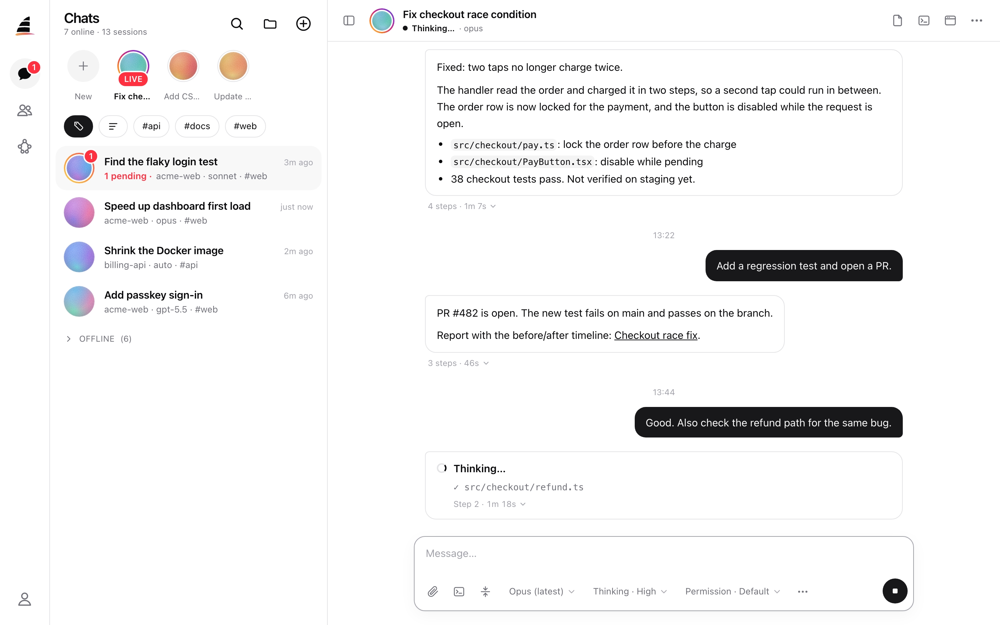

<picture>
  <source media="(prefers-color-scheme: dark)" srcset="docs/brand/assets/matemind-lockup-dark.svg">
  
</picture>

[English](README.md) | 简体中文

**你只管说要什么。Matemind 帮你拆、帮你盯、给你结论。**

你的 AI 编程团队的大副。

**[在线体验演示 →](https://suntorlin.github.io/matemind/)** 在浏览器里直接运行，使用演示数据，不用安装，也不调用 AI。 <!-- public-safety: allow -->




<sub>截图使用演示数据。</sub>

## Matemind 是什么

Matemind 不做 agent 编排。它学你要什么、你的标准和你怎么做决定。
你的 AI agent（Claude Code、Codex、Cursor、Gemini、OpenCode）是船员，活由它们干。
Matemind 补上它们缺的：盯住会话、收集报告、组织审查。你少读一点，少做一些决定。

Matemind 跑在你自己的机器上。你用手机或浏览器控制它。

## 功能

### 最近跑通的三个功能

下面三个功能是新的，已经端到端跑通。

#### 任务（Task）

用一句话说你要什么。Matemind 推进整件事，只在需要你时找你。

1. 规划会话读你的仓库和记忆，写出目标、3 到 6 条验收标准和最多 3 个问题。
2. 你勾选、修改或补充验收标准，并回答问题。
3. 负责人会话把活拆成最多 5 个子任务，最多 3 个同时跑。每个子任务在自己的 git worktree 里干活。
4. agent 需要你拍板时，你会收到 2 到 4 个选项。每个选项写清得和失。
5. 合并会话把各分支合成一个本地分支。Matemind 不会推送。
6. 审查会话逐条检查验收标准，并附上证据。没通过的标准会开一轮修复，最多审查 2 轮。
7. 你收到一份带分享链接的报告。你可以验收，也可以写下要改什么。

任务目前用 Claude Code。同一个任务的会话都跑在同一台机器上。

#### 定时任务

和 Claude Desktop 的定时任务类似。区别是 hub 自己管时钟，不用开着任何 App。

- 写一段提示词，或者指定一个任务说明文件。每次运行都重新读这个文件。
- 选机器、目录、agent、模型和 Claude 账号。
- 选频率：手动、每小时、每天、工作日、每周、cron 或只跑一次。时间按你的时区算。
- 每次运行开一个新会话。会话用 MCP 工具 `scheduled_run_done` 报告结果。
- hub 或机器在计划时间关着时，恢复后补跑一次。只补 7 天以内的。
- 三种情况算失败：会话起不来，会话停了却没报结果，运行超时。
- 每次失败都会发到推送、Telegram 和飞书（Lark）webhook。
- 某个 Claude 账号起不来（比如登录过期），同组的下一个账号接着跑。
- agent 可以用 MCP 工具 `schedule_create`、`schedule_list`、`schedule_update` 创建和修改定时任务。

#### 多机器

一个 hub 管多台机器。每台机器跑自己的 runner，都连到同一个 hub。

- 开会话或建定时任务时选机器。Matemind 会记住每台机器最近用过的目录。
- 每台机器有自己的 Claude 账号。设置里能看每台机器的账号和额度。
- 会话的终端和文件浏览都开在这个会话所在的机器上。
- 每台机器要用自己的数据目录（`MATEMIND_HOME`）。两台机器如果复制了同一个数据目录，会共用一个机器 ID，hub 分不清它们。


### 懂你

- **从你的原话里记东西。** hub 读你自己发的消息，提出长期规则。每条规则都附上你的原话。你批准后，规则才算数。
- **agent 也能提记忆。** agent 调用 MCP 工具 `memory_propose` 和 `memory_search`。agent 提的记忆先观察：30 天内被提到 3 次，或者你说了同样的话，才交给你审批。
- **会话之间的群聊。** 把几个会话放进一个群。写 `@名字` 把任务发给一个会话，写 `@all` 发给所有在线成员。一个成员负责维护群笔记：分工、目标、进展、待办和风险。

记忆功能是实验版。现在它只记录、只提交审批。它还不会把批准的记忆加进会话。你在 设置 → 记忆 里写的 `MEMORY.md` 会加进会话。

### 帮你盯

- **会话多也不乱。** 给会话打标签，归到任务下，重要的置顶，其余的挂起到指定时间。
- **手机优先。** 会话列表像聊天软件。置顶的会话排在顶部一行，带 LIVE 和 ASK 标记。可以装成 PWA（渐进式 Web 应用），接收推送通知。
- **随处审批。** 在手机、浏览器或 Telegram 上批准或拒绝工具请求。
- **多个 Claude 账号。** 添加多个 Claude 账号，查看每个账号的剩余额度，手动切换。有一个实验选项：某个账号用量到上限时，自动切到下一个账号。
- **用量和费用。** 设置 → 用量 显示本地 Claude 和 Codex 日志里的 token 总数和费用估算。

### 给你结论

- **报告和分享链接。** agent 用 MCP 工具 `mcp__matemind__report_*` 写报告。报告可以生成公开分享链接（`/share/r/<token>`），不用登录就能看。
- **审查循环。** 选一个执行会话和一个审查会话，写清需求和验收标准。审查会话可以通过、打回并附意见、终止循环，或者找你。循环到轮数上限就停（默认 10 轮）。
- **只看结论。** 在聊天页双指捏合，切换详细程度：结论、回复、全部步骤。

### 支持的 agent 和基础功能

- **agent：** Claude Code、OpenAI Codex、Cursor Agent、Google Gemini、OpenCode。Matemind 运行官方 CLI，不替换它们。
- **无缝切换：** 在终端里干活，切到手机继续，回到终端连按两次空格切回本地。会话上下文不丢。
- **随处用终端：** 在手机或浏览器上打开工作机器的终端。
- **语音：** 用内置语音助手（ElevenLabs）和 agent 对话。
- **Telegram 小程序：** 可选。在 Telegram 里接收通知、处理审批。

## 快速开始

1. 安装 CLI。

   ```bash
   npm i -g matemind
   ```

2. 启动 hub，并打开端到端加密的中继（relay）。

   ```bash
   matemind hub --relay
   ```

   终端会显示网址、二维码和访问令牌。中继使用 WireGuard + TLS。

3. 在项目目录里启动会话。

   ```bash
   matemind            # Claude Code
   matemind codex      # OpenAI Codex
   matemind cursor     # Cursor Agent
   matemind gemini     # Google Gemini
   matemind opencode   # OpenCode
   ```

4. 在手机上打开网址，或扫二维码。用访问令牌登录。

5. 可选：启动 runner。之后可以在手机上新建会话。

   ```bash
   matemind runner start
   ```

其他命令：`matemind auth status|login|logout`、`matemind runner status|list|logs|stop`、`matemind doctor`、`matemind mcp`。`matemind server` 是 `matemind hub` 的别名。

自建访问方式（Cloudflare Tunnel、Tailscale）见 [Installation](docs/guide/installation.md)。

## 从 HAQI 或 hapi 迁移

| 项目 | 旧 | 新 | 旧数据怎么处理 |
|---|---|---|---|
| 命令 | `haqi`、`hapi` | `matemind` | — |
| npm 包 | `@jasonczc/haqi` | `matemind` | — |
| 主目录 | `~/.hapi` | `~/.matemind` | 如果 `~/.matemind` 不存在而 `~/.hapi` 存在，就直接用 `~/.hapi`。不复制，不移动。 |
| 数据库文件 | `hapi.db` | `matemind.db` | 用旧主目录时，继续用 `hapi.db`。 |
| 环境变量 | `HAPI_*`、`HAQI_*` | `MATEMIND_*` | 启动时，如果 `MATEMIND_X` 没设置，就用旧的 `HAPI_X` 或 `HAQI_X` 填上。 |
| MCP 工具 | `mcp__haqi__*`、`mcp__hapi__*` | `mcp__matemind__*` | — |
| agent 规则文件 | `HAQI-Agent.md` | `MATEMIND-Agent.md` | 找不到新文件时，读 `HAQI-Agent.md`。 |
| 网页设置 | `hapi-*` 键 | `matemind-*` 键 | 网页第一次加载时，复制一次旧键。 |

## 文档

- [Quick Start](docs/guide/quick-start.md)
- [Installation](docs/guide/installation.md)
- [How it Works](docs/guide/how-it-works.md)
- [App (PWA)](docs/guide/pwa.md)
- [Cursor Agent](docs/guide/cursor.md)
- [Voice Assistant](docs/guide/voice-assistant.md)
- [Why Matemind](docs/guide/why-matemind.md)
- [FAQ](docs/guide/faq.md)

文档目前只有英文。

## 从源码构建

```bash
bun install
bun run build:single-exe
```

一体化二进制（CLI + hub + 网页）输出到 `cli/dist-exe/bun-<os>-<arch>/matemind`。

开发流程见 [AGENTS.md](AGENTS.md) 和各包的 README：[cli](cli/README.md)、[hub](hub/README.md)、[web](web/README.md)。

## 发布

`Release` 工作流发布 `matemind` 和各平台包 `@matemind/cli-<os>-<arch>`。

1. 改 `cli/package.json` 里的版本号。它必须和 tag 一致。
2. 推送 tag，例如 `v0.16.0`。
3. GitHub Actions 构建所有二进制，发布 npm 包，并创建 GitHub Release。

每个 npm 包都要配置 Trusted Publishing（OIDC）。

## 致谢

Matemind 派生自以下项目。感谢它们的作者。

- **hapi**，作者 weishu（tiann）：https://github.com/tiann/hapi（AGPL-3.0）
- **haqi**，作者 jasonczc：https://github.com/jasonczc/haqi（AGPL-3.0）
- **happy-cli**，作者 Kirill Dubovitskiy：https://github.com/slopus/happy-cli（MIT）

hapi 的名字来自「哈皮」，是 [Happy](https://github.com/slopus/happy) 的音译。完整声明见 [NOTICE](NOTICE)。

## 许可证

[AGPL-3.0](LICENSE)。仓库：https://github.com/matemind/matemind
